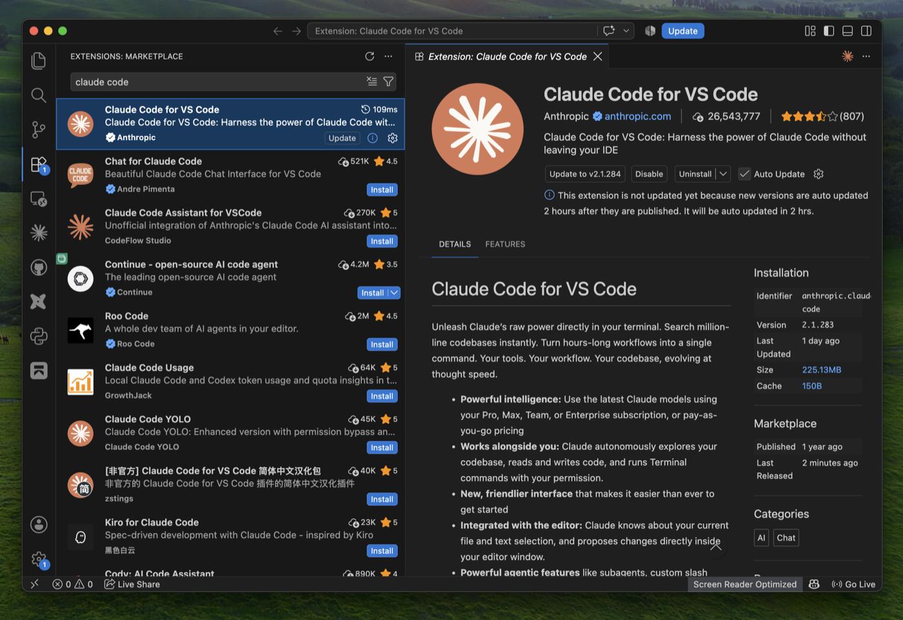
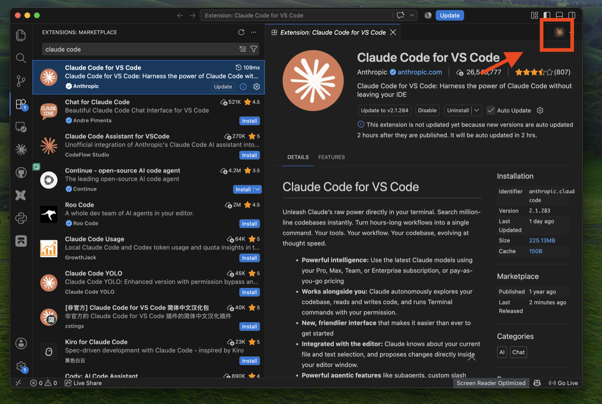
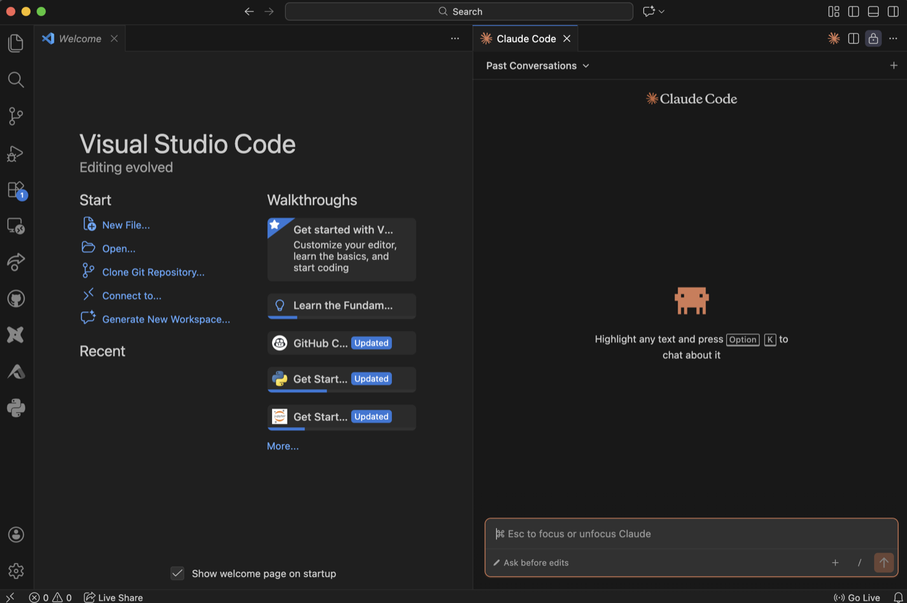

# 00 — Setup & installation (10 min, ideally **before** the session)

Goal: this repo open in VSCode, Claude Code running inside it, and every tool the 3 exercises need installed.

**Before you start:** you need a paid Claude plan (Pro or higher) at [claude.ai](https://claude.ai). Claude Code doesn't work on the free plan.

## Step 1: Check what you already have (1 min)

Open a terminal (**macOS:** `Cmd + Space` → *Terminal* · **Windows:** Windows key → *Terminal*) and run:

```bash
claude --version   # Claude Code
code --version     # VSCode
git --version      # any version
python3 --version  # 3.9 or newer   (Windows: python --version)
node -v            # v22 or newer   (only needed for exercise 3)
```

✅ All print a version → jump to [Step 5](#step-5-install-the-claude-code-extension-in-vscode-2-min) (and check the extension is there).
❌ `command not found` / `not recognized` → do the matching step below for that tool only.

## Step 2: Claude Code in the terminal (3 min)

Install it first: once Claude Code works, **you can ask it for help with every later step.** The VSCode extension uses this same installation.

<details>
<summary> <b>macOS</b></summary>

```bash
curl -fsSL https://claude.ai/install.sh | bash
```

Quit the terminal (`Cmd + Q`; the red ● only closes the window) and open a new one.

</details>

<details>
<summary> <b>Windows</b></summary>

Claude Code uses Git Bash on Windows, so Git comes first:

```powershell
winget install --id Git.Git -e
```

Keep the installer defaults, close the terminal and open a new one. Then:

```powershell
irm https://claude.ai/install.ps1 | iex
```

Close the terminal and open a new one.

> *"winget is not recognized"*? Open the **Microsoft Store**, search **App Installer**, click **Update** or **Get**, reopen the terminal.

</details>

**First login:** type `claude`, pick a colour theme, choose **Claude account with subscription**, log in in the browser and click **Authorize**. Type `hello`; Claude answers. Type `/exit`.

## Step 3: VSCode (1 min)

| macOS | Windows |
|---|---|
| `brew install --cask visual-studio-code` (or download from [code.visualstudio.com](https://code.visualstudio.com)) | `winget install --id Microsoft.VisualStudioCode -e` |

Check with `code` in a new terminal: a VSCode window opens.

❌ **macOS** *"command not found: code"*: open VSCode from Applications → `Cmd + Shift + P` → type **shell command** → **Shell Command: Install 'code' command in PATH**. Quit and reopen the terminal.
❌ **Windows** *"not recognized"*: close every terminal and open a new one; if it still fails, reinstall VSCode with **Add to PATH** ticked.

## Step 4: Python and Node (2 min)

| Tool | macOS | Windows | Why |
|---|---|---|---|
| **Python 3** | `brew install python` or [python.org](https://www.python.org/downloads/) | [python.org](https://www.python.org/downloads/) (tick **"Add to PATH"**) | Exercise 2 (book-to-skill) |
| **Node.js 22+** | `brew install node` or [nodejs.org](https://nodejs.org) (LTS) | [nodejs.org](https://nodejs.org) (LTS) | Exercise 3 (rea) |

> No Homebrew on Mac? The website installers work just as well. After installing anything, **reopen VSCode and the terminal**.

## Step 5: Install the Claude Code extension in VSCode (2 min)

1. In VSCode open **Extensions**: the four-squares icon in the left sidebar, or `Cmd + Shift + X` (macOS) / `Ctrl + Shift + X` (Windows).
2. Search `claude code` and pick **Claude Code for VS Code** by **Anthropic**, the one with the blue ✓ verified badge.
3. Click **Install**. When it's done, the page shows **Disable** / **Uninstall** instead of Install.

   

> ⚠️ **Many look-alike extensions** show up in this search (Chat for Claude Code, Claude Code YOLO, …). Only install the one published by **Anthropic**.

Optional, nice for this workshop:

```bash
code --install-extension ms-vscode.live-server       # preview the slides inside VSCode
code --install-extension bierner.markdown-mermaid    # render diagrams in markdown
```

## Step 6: Clone this repo (1 min)

**Option A, no terminal:** in VSCode press `Cmd + Shift + P` (Windows `Ctrl + Shift + P`) → **Git: Clone** → paste
`https://github.com/wukimidaire/claude-code-lunch-and-learn.git` → pick a folder → **Open**.

**Option B, terminal:**

```bash
git clone https://github.com/wukimidaire/claude-code-lunch-and-learn.git
cd claude-code-lunch-and-learn
code .
```

> Claude Code must run **inside this folder**; that's how it finds the workshop skills.

## Step 7: Open Claude in VSCode and trust the folder (1 min)

1. Click the **Claude icon** (the orange spark ✳) at the top right of the editor, or press `Cmd + Esc` (macOS) / `Ctrl + Esc` (Windows).

   

2. Log in if asked (same Claude account as in Step 2).
3. When asked *"Do you trust the files in this folder?"* → **Yes**.
4. When asked to install the **rea** plugin (from `morluto/rea`) → **Yes / Install**, then restart Claude Code.
5. Type `hello` in the Claude panel. Claude answers.

   

## Step 8: Install rea manually (only if you weren't asked in Step 7)

In the Claude panel type:

```
/plugin marketplace add morluto/rea
/plugin install rea@rea
```

Restart Claude Code. Still failing? In a terminal: `npx rea-agents setup` → choose **Claude Code** → restart.
Use **one** route only; doing both gives you two `rea` servers.

## Step 9: Verify (1 min)

Paste this into Claude:

> **Check my workshop setup: list the skills and MCP servers available in this project, and run
> `claude doctor`, `python3 --version`, `node -v` and `python3 .claude/skills/book-to-skill/scripts/extract.py --check`.
> Tell me what's missing and how to fix it.**

- [ ] Typing `/` shows `problem-statement`, `problem-solution`, `compare-options`, `interview`, `skill-creator`, `skill-audit`, `book-to-skill`
- [ ] `/mcp` lists **rea** as connected
- [ ] The extractor check runs (missing *optional* packages are fine)

## Troubleshooting

| Problem | Fix |
|---|---|
| *"command not found: claude"* / *"not recognized"* | Close all terminals and open a new one. Still failing? Run the install command again |
| *"Claude Code requires git-bash"* (Windows) | Git isn't installed; do the Git part of Step 2, reopen the terminal |
| *"running scripts is disabled on this system"* (Windows) | `Set-ExecutionPolicy -Scope CurrentUser RemoteSigned`, answer `Y`, run the install again |
| Login loops or shows a free-plan error | Your account has no paid plan; upgrade at [claude.ai/upgrade](https://claude.ai/upgrade) |
| No Claude icon in VSCode | Quit VSCode completely (`Cmd + Q` / close all windows) and reopen; check the extension is the **Anthropic** one |
| Skills don't show up when typing `/` | Claude was started outside the repo folder. **File → Open Folder** → this repo, then reopen Claude |
| `python3` not found on Windows | Use `python`, or reinstall Python with **"Add to PATH"** ticked |
| `node -v` shows v18 or v20 / rea fails in `/mcp` | Install the current LTS from nodejs.org, reopen VSCode, restart Claude |
| Stuck for more than 3 minutes | Raise your hand. Do exercises 1 and 2 meanwhile; they don't need Node |

➡️ Next: [01 Metaskills](01-metaskills.md)
